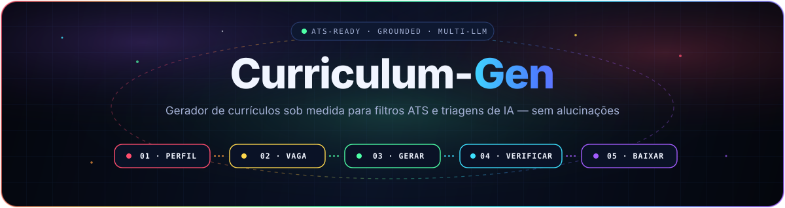
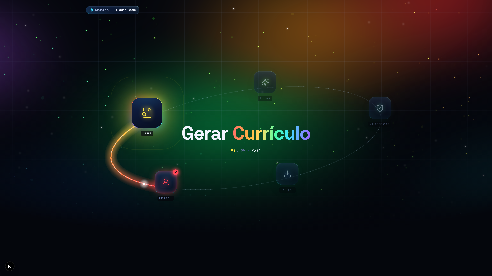
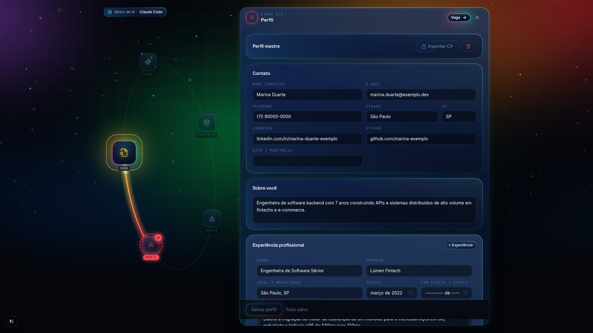
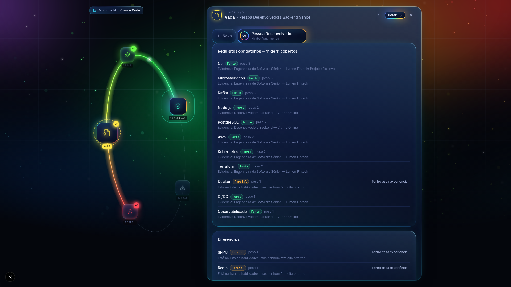
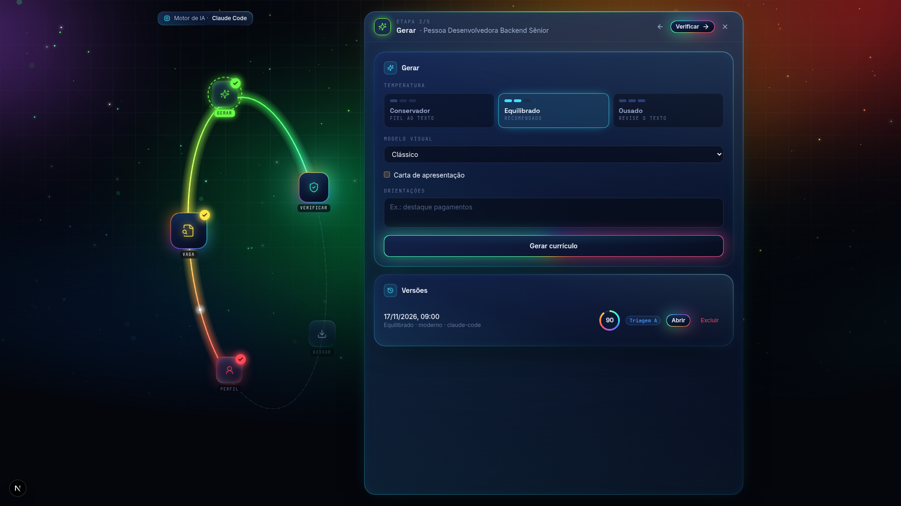
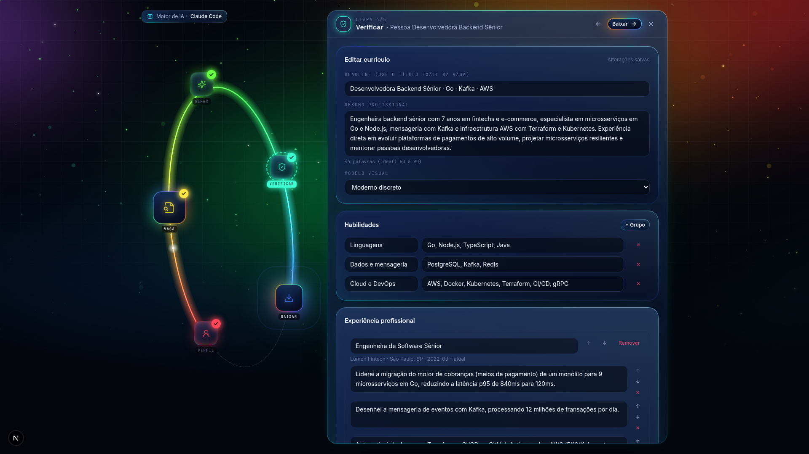
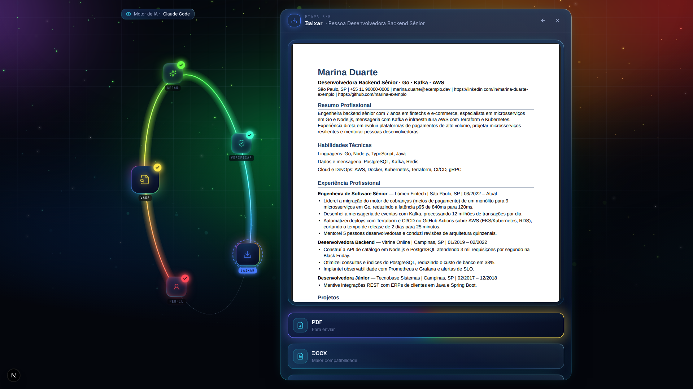
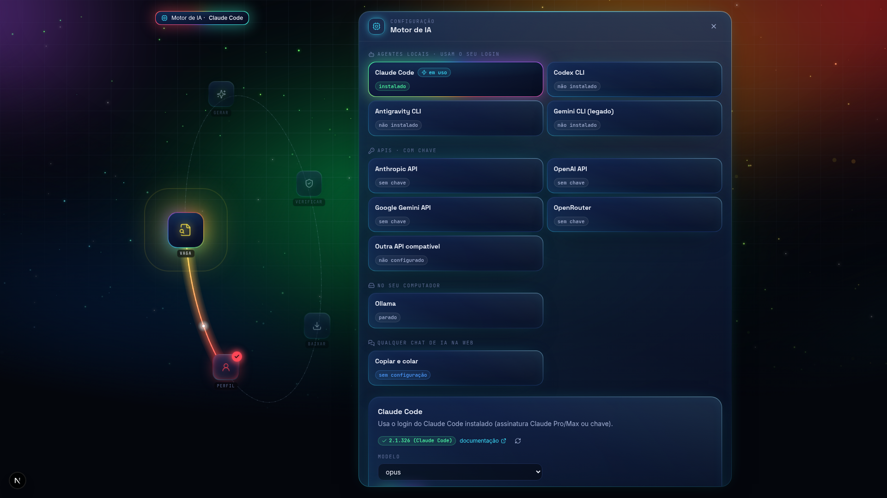
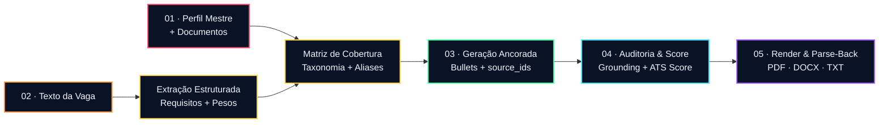

<div align="center">



<br />

[](https://nextjs.org/)
[](https://react.dev/)
[](https://www.typescriptlang.org/)
[](https://tailwindcss.com/)
[](#-motor-de-ia-multi-provider)
[](#-arquitetura-do-pipeline-ats)
[](./LICENSE)

<p align="center">
  <strong>Gerador local de currículos sob medida otimizado para filtros ATS e triagens de IA (Gupy, Workday, Greenhouse, Lever)</strong><br />
  <em>Grounding estrito nos fatos reais do seu perfil · Score ATS em tempo real · Exportação limpa em PDF, DOCX e TXT</em>
</p>



</div>


## ✨ Por que o Curriculum-Gen?

Plataformas modernas de recrutamento (**Gupy, Workday + HiredScore, Greenhouse, Lever, Ashby**) ranqueiam candidatos cruzando **extração estrutural do arquivo (Parsing)**, **correspondência exata de palavras-chave** e **aderência semântica por IA**.

O **Curriculum-Gen** atua nas duas pontas desse funil sem jamais inventar informações:

| Pilar | Como funciona no Curriculum-Gen |
| :--- | :--- |
| 🛡️ **Zero Alucinações (*Strict Grounding*)** | Cada bullet, métrica e habilidade gerada referencia fatos reais do seu perfil (`source_ids`) ou documentos anexados. Números ou tecnologias sem lastro no perfil são bloqueados automaticamente. |
| 🎯 **Espelhamento Exato de Termos da Vaga** | Normaliza sinônimos e variações (`K8s` ↔ `Kubernetes`, `NodeJS` ↔ `Node.js`) usando taxonomia integrada e aplica no currículo a grafia exata exigida pelo anúncio da vaga. |
| 📊 **Score ATS + Triagem Simulada (A–D)** | Calcula o score determinístico de compatibilidade (keywords obrigatórias, diferenciais, título, recência, higiene de formato e parse-back) aliado a um parecer de triagem simulada. |
| 📄 **PDF, DOCX e TXT 100% Parseáveis** | Layout de coluna única sem tabelas ocultas, caixas de texto ou colunas laterais. Após gerar o PDF/DOCX, o sistema **re-extrai o texto do arquivo binário** (*parse-back validation*) para garantir que nenhum dado foi corrompido. |
| 🔌 **Liberdade Total de Motor de IA** | Use agentes locais de CLI (Claude Code, Codex, Antigravity, Gemini), chaves de API (Anthropic, OpenAI, Gemini, OpenRouter, compatíveis com OpenAI), **Ollama local** ou o modo **Copiar e Colar** com qualquer chat da web. |
| 🔒 **Local-First & Privado** | Seu perfil mestre, vagas, documentos e chaves ficam exclusivamente na sua máquina em `data/` (fora do Git). |


## 🪐 Fluxo Orbital em 5 Etapas

Toda a experiência acontece em uma única tela interativa (**Flow Orbit**). Cada nodo da órbita acende com sua cor no espectro arco-íris conforme você avança:

### `01` · Perfil Mestre & Evidências (`#ff4d6d`)
Cadastre suas informações de contato, resumo, habilidades, formação, certificações, idiomas, experiências e projetos — ou **importe um currículo existente (PDF/DOCX)** para preenchimento automático. Anexe também **documentos de apoio** aos seus projetos e use **Sugerir fatos** para extrair conquistas verificáveis.

<div align="center">
  
</div>

---

### `02` · Análise da Vaga & Cobertura de Lacunas (`#ffd84d`)
Cole a descrição da vaga. O motor extrai requisitos obrigatórios e diferenciais, cruza com seu perfil mestre (match exato, alias e semântico) e exibe o mapa de cobertura (**Forte**, **Parcial** ou **Lacuna**). Caso você possua uma competência que ainda não estava documentada nos fatos do perfil, registre-a direto pelo botão **"Tenho essa experiência"**.

<div align="center">
  
</div>

---

### `03` · Geração Sob Medida (`#4dffa6`)
Escolha a temperatura de reescrita (**Conservador**, **Equilibrado** ou **Ousado**), o modelo visual (**Clássico**, **Moderno discreto** ou **Compacto**), adicione orientações extras e gere opcionalmente uma **Carta de Apresentação** alinhada à vaga.

<div align="center">
  
</div>

---

### `04` · Verificação, Edição Inline & Grounding (`#3de1ff`)
Revise e edite o headline, resumo, grupos de habilidades e cada bullet das experiências. A cada alteração, o **Score ATS**, a **auditoria de grounding** e a prévia do documento são recalculados instantaneamente.

<div align="center">
  
</div>

---

### `05` · Visualização Final & Download (`#a35cff`)
Confira a folha renderizada exatamente como o recrutador verá e baixe em **PDF** (camada de texto vetorial limpa), **DOCX** (OpenXML nativo com máxima compatibilidade ATS) ou **TXT** (pronto para colar em campos de portais).

<div align="center">
  
</div>


## 🤖 Motor de IA Multi-Provider

No botão **Motor de IA** (canto superior esquerdo da órbita), você escolhe e testa em tempo real quem executa a análise e a geração:

<div align="center">
  
</div>

<br />

| Categoria | Provedores Suportados | Autenticação / Configuração |
| :--- | :--- | :--- |
| **Agentes Locais (CLI)** | **Claude Code** (`claude`), **Codex CLI** (`codex`), **Antigravity CLI** (`agy`), **Gemini CLI** (`gemini`) | Reutiliza a sessão/login já autenticada no próprio CLI da sua máquina |
| **APIs Diretas** | **Anthropic**, **OpenAI**, **Google Gemini**, **OpenRouter**, **Compatível com OpenAI** (Groq, DeepSeek, Mistral, LM Studio, vLLM…) | Chave configurada na própria interface (`data/ai-settings.json`) ou via variáveis de ambiente (`ANTHROPIC_API_KEY`, `OPENAI_API_KEY`, `GEMINI_API_KEY`, `OPENROUTER_API_KEY`) |
| **Execução Local** | **Ollama** (`http://localhost:11434`) | Sem chave — detecta automaticamente os modelos instalados localmente |
| **Ponte Manual (Web)** | **Copiar e Colar** (ChatGPT, Claude.ai, Gemini Web, Copilot, DeepSeek, Grok…) | Zero configuração — o app monta o prompt estruturado, você cola no seu chat favorito e devolve o JSON de resposta |


## 🧠 Arquitetura do Pipeline ATS




## 🚀 Como Executar Localmente

### Pré-requisitos
- **Node.js 20+** e **pnpm**
- Qualquer uma das opções de **Motor de IA** (ex.: Claude Code logado, Ollama rodando localmente, chave de API ou modo Copiar e Colar).

### Instalação e Uso

```bash
# 1. Instale as dependências
pnpm install

# 2. Inicie o servidor de desenvolvimento
pnpm dev
```

Acesse **[http://localhost:3000](http://localhost:3000)** no navegador.

### Scripts Disponíveis

| Comando | Descrição |
| :--- | :--- |
| `pnpm dev` | Inicia o servidor de desenvolvimento em `http://localhost:3000` |
| `pnpm build` | Compila a aplicação Next.js para produção |
| `pnpm start` | Inicia o servidor de produção |
| `pnpm typecheck` | Executa a verificação estática de tipos do TypeScript (`tsc --noEmit`) |
| `pnpm test` | Executa a suíte de testes no Vitest (renderização PDF/DOCX/TXT, parse-back, score ATS, grounding e camada de IA) |

---

## 📁 Estrutura do Projeto

```text
curriculum-gen/
├── src/
│   ├── app/                  # Rotas App Router (Next.js 15) + API Routes (/api/profile, /api/jobs, /api/documents, /api/ai)
│   ├── components/           # Interface orbital (Studio, FlowOrbit, AiSettings, ManualBridge, ScoreRing, Backdrop)
│   │   ├── job/              # Painéis de análise, cobertura, geração, score e edição do currículo
│   │   └── steps/            # Etapas de Perfil, Vaga e Download
│   └── lib/
│       ├── ai/               # Camada Multi-LLM (CLI agents, APIs HTTP, Ollama, Manual Bridge, catálogo de modelos)
│       ├── render/           # Motores de exportação ATS-safe (pdf.ts, docx.ts, txt.ts, model.ts)
│       ├── matching.ts       # Cruzamento exato, por alias e semântico entre perfil e vaga
│       ├── taxonomy.ts       # Dicionário de sinônimos e normalização de tecnologias/competências
│       ├── grounding.ts      # Validador anti-alucinação contra fatos do perfil e documentos anexados
│       ├── scoring.ts        # Cálculo determinístico do Score ATS
│       ├── validate.ts       # Re-extração (parse-back) de PDF e DOCX gerados
│       └── pipeline.ts       # Orquestração ponta a ponta de análise, geração e avaliação
├── tests/                    # Testes automatizados do núcleo e da camada de IA (Vitest)
├── docs/                     # Plano de implementação, screenshots e assets visuais
└── data/                     # Armazenamento local (perfil, vagas, documentos e ajustes de IA — ignorado pelo Git)
```


## 📄 Licença

Este projeto é distribuído sob a licença [MIT](./LICENSE).


<div align="center">
  <sub>Construído com foco em precisão técnica, transparência e máxima compatibilidade ATS.</sub>
</div>
