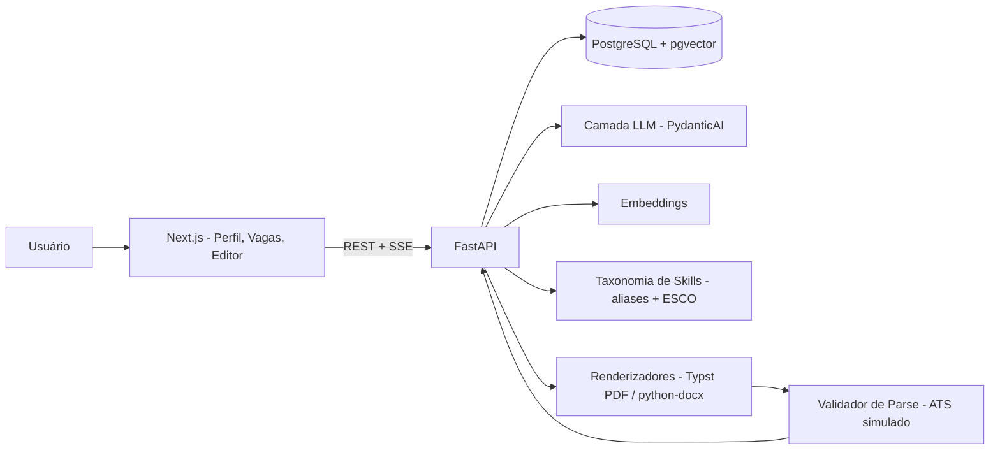
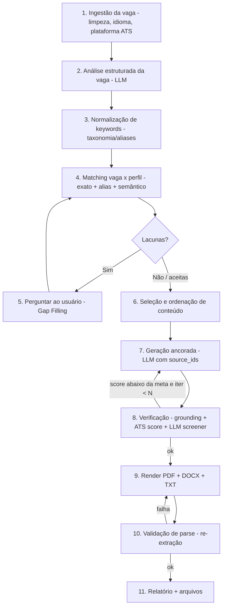
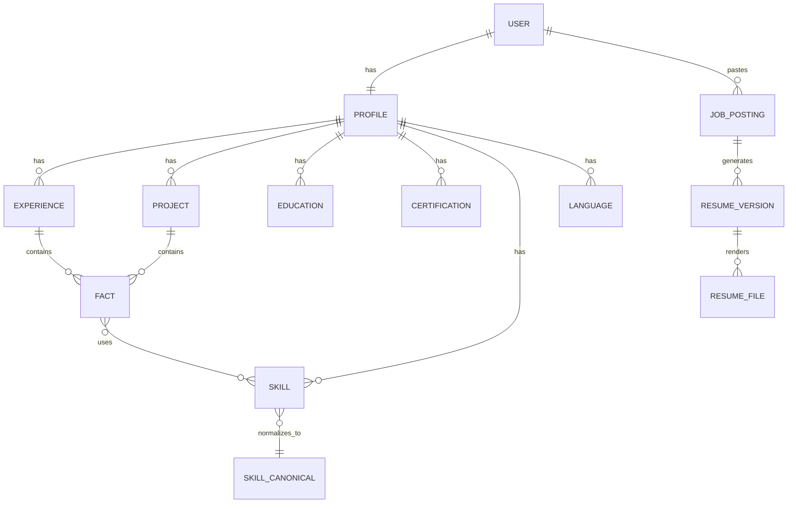

# Plano de Implementação — `curriculum-gen` (Gerador de Currículos ATS)

## 1. Objetivo e premissas

**Objetivo principal:** dado um **perfil mestre** (todas as informações do usuário) e o **texto de uma vaga**, gerar um currículo que **maximize o ranqueamento em filtros ATS/IA** (Gupy, Workday + HiredScore, Greenhouse, Lever, Ashby, iCIMS etc.) e que também convença o recrutador humano que lê logo depois.

### O que a pesquisa mostrou sobre como os ATS funcionam (2025–2026)

| Fato | O que isso significa no projeto |
|---|---|
| ATS modernos **ranqueiam**, não reprovam: quem fica embaixo da lista simplesmente nunca é visto (o recrutador olha os 10–20% do topo). A Gupy diz isso oficialmente. | A meta é **ficar no topo do ranking**, então precisamos de um *score* que dê para medir |
| O pipeline é **Parsing → Extração de campos → Score (keywords + semântica) → Ranking** | Temos que acertar **as duas camadas**: o parse (formato) e o score (conteúdo) |
| O Workday/HiredScore pontua por **% de match de palavras-chave** (notas A–D, cortes de 60–70%) | Cobertura de keywords com **grafia exata** da vaga |
| O Greenhouse descarta blocos com **títulos de seção fora do padrão** | Usar só títulos canônicos ("Experiência Profissional", "Experience") |
| O Lever é rígido com **contato** (telefone sem `+55` pode virar campo nulo) | Telefone normalizado em E.164, contato no corpo do documento (nunca no header/footer) |
| A IA semântica (Gupy, Ashby, HiredScore) entende contexto e **penaliza *keyword stuffing***. Texto branco escondido é detectado e desclassifica | As keywords precisam aparecer **dentro das experiências**, e não só numa lista |
| Ter o **título exato da vaga** no cabeçalho ou no resumo aumenta muito o número de retornos | O headline espelha o título da vaga |
| Coluna única, sem tabelas, caixas de texto, ícones ou barras de nível. DOCX é o formato mais seguro; PDF só funciona se tiver camada de texto real | Template de coluna única, gerado como **DOCX e PDF**, e **validado automaticamente** |

> [!IMPORTANT]
> **Sobre o "100% de compatibilidade":** o algoritmo de cada ATS é fechado, então nenhuma ferramenta consegue *garantir* 100%. O que o sistema faz é: (1) **eliminar 100% das falhas de parsing**, porque isso é verificável; (2) **maximizar e medir** a cobertura dos requisitos da vaga com um *score* que imita os ATS (keywords exatas + semântica + avaliação por LLM); (3) **mostrar com transparência as lacunas reais** e perguntar ao usuário se ele tem aquela experiência, para que ela seja adicionada ao perfil.

> [!WARNING]
> **Princípio inegociável: grounding (nada inventado).** Cada frase do currículo gerado precisa **apontar para um fato do perfil** (`source_ids`). O sistema reescreve, reordena, seleciona e usa a terminologia da vaga, mas **não cria** experiências, tecnologias ou números. Isso também é estratégico: currículo inflado passa no ATS e reprova na entrevista técnica ou na checagem de referências.

---

## 2. Stack tecnológica recomendada

| Camada | Tecnologia | Por quê |
|---|---|---|
| **Frontend** | Next.js 15 (App Router) + TypeScript + Tailwind + shadcn/ui + TanStack Query + React Hook Form/Zod | Formulários complexos para o perfil, preview lado a lado e streaming do progresso da geração |
| **Backend / IA** | **Python 3.12 + FastAPI + Pydantic v2** | O ecossistema de NLP, PDF e DOCX (PyMuPDF, python-docx, spaCy, sentence-transformers) está em Python |
| **Orquestração LLM** | **PydanticAI** (ou LiteLLM + Instructor) com *structured outputs* | Não fica preso a um fornecedor: Gemini Pro, Claude ou GPT, e Ollama para rodar local. Saídas tipadas e validadas |
| **LLM** | Um modelo de raciocínio de ponta para análise e geração + um modelo rápido/barato para extração e julgamento | Equilíbrio entre qualidade e custo. Ver a pergunta em aberto 2 |
| **Embeddings** | `text-embedding` do provedor escolhido **ou** `multilingual-e5-large` / `bge-m3` local | Precisa ser **multilíngue** (pt-BR + en) |
| **Banco** | **PostgreSQL 16 + pgvector** | Dados relacionais do perfil e busca semântica no mesmo banco |
| **ORM / migrations** | SQLAlchemy 2 + Alembic | Padrão consolidado |
| **Render PDF** | **Typst** (CLI ou `typst-py`) | PDF vetorial com camada de texto limpa e ordem de leitura determinística, compila em milissegundos. Não usar React-PDF: ele embaralha o fluxo de texto |
| **Render DOCX** | **python-docx** | É o formato com a maior taxa de parse nos ATS. Parágrafos e estilos nativos (`Heading 1`, `List Bullet`) |
| **Validação de parse** | PyMuPDF + pdfminer.six + docx2txt + um parser LLM que faz o papel de "ATS simulado" | Lê de volta o arquivo gerado e confere se cada campo foi extraído certo |
| **Taxonomia de skills** | Dicionário próprio de aliases + **ESCO** (tem pt e en) + O\*NET + StackShare | Normaliza variações (`K8s` → `Kubernetes`, `JS` → `JavaScript`) |
| **Fila / streaming** | SSE para o progresso. `arq` (Redis) se a geração passar de ~30 s | A geração com loop de verificação leva entre 20 e 60 s |
| **Auth** | Better-Auth / Auth.js (se for multiusuário) | Ver a pergunta em aberto 1 |
| **Infra** | Docker Compose (dev), `uv` (Python), `pnpm` (JS), GitHub Actions | Ambiente que se reproduz igual em qualquer máquina |
| **Testes** | pytest + golden datasets, Vitest, Playwright | Medir a qualidade da geração, não só se o código roda |

---

## 3. Arquitetura



### Pipeline principal de geração (o coração do projeto)



#### Detalhe de cada etapa

1. **Ingestão:** sanitiza o texto colado, detecta o idioma (o currículo sai **no idioma da vaga**) e detecta a plataforma (Gupy, Workday...) quando o usuário cola a URL, para aplicar ajustes específicos de cada uma.
2. **Análise da vaga (LLM, saída tipada `JobAnalysis`):**
   - `job_title` exato e variações, `seniority`, `years_required`
   - `hard_skills[]` com **grafia exata**, forma por extenso + sigla, `required | nice_to_have`, peso (calculado por frequência, posição no texto e seção "requisitos" vs "diferenciais")
   - `soft_skills[]`, `responsibilities[]`, `domain_keywords[]` (setor, produto), `certifications[]`, `education[]`, `languages[]`, `location/modalidade`
3. **Normalização:** cada keyword vira `{canonical, surface_form_da_vaga, aliases}`. **No currículo sempre se usa a grafia da vaga** (se a vaga escreve "Node.js", não vale "NodeJS").
4. **Matching híbrido:** monta uma **matriz de cobertura** `requisito → evidências do perfil → força (forte / parcial / adjacente / nenhuma)`, combinando três sinais:
   - match exato ou por alias (determinístico)
   - similaridade de embeddings (pgvector) entre o requisito e cada **fato atômico** do perfil
   - confirmação por LLM nos casos ambíguos
5. **Gap filling interativo:** para requisitos sem evidência, o sistema pergunta: *"A vaga pede Terraform. Você já usou? Onde?"*. O que o usuário responde **entra no perfil mestre** e passa a servir para as próximas vagas.
6. **Seleção e ordenação:** ranqueia experiências, projetos e bullets por relevância para a vaga, respeitando um orçamento de espaço (1 página até ~5 anos de experiência, 2 páginas acima disso). Projetos aparecem em destaque quando cobrem lacunas que a experiência profissional não cobre.
7. **Geração ancorada (LLM, saída tipada `TailoredResume`):**
   - **Headline** com o título da vaga (ex.: "Desenvolvedor Back-end Sênior | Python · AWS · Microsserviços")
   - **Resumo** de 3–4 linhas com as 5–8 keywords mais pesadas e os anos de experiência
   - **Habilidades** agrupadas com os termos da vaga primeiro e a sigla junto da forma por extenso: "Amazon Web Services (AWS)"
   - **Bullets** no formato *verbo de ação + o que + como (tecnologias da vaga) + resultado quantificado*, onde **cada bullet carrega `source_ids`**
   - Keywords obrigatórias aparecem de **2 a 3 vezes, de forma natural** (skills + contexto), com teto anti-stuffing
   - Skills relevantes aparecem na experiência **mais recente em que de fato foram usadas** (o ATS leva recência em conta)
8. **Loop de verificação** (máximo de N=3 iterações):
   - **Grounding check:** um LLM-juiz confere se cada frase é sustentada pelos `source_ids`. Qualquer alucinação é removida ou reescrita
   - **ATS Score determinístico** (ver seção 5)
   - **LLM Screener:** um prompt que se comporta como um ATS de IA (estilo HiredScore/Gupy) dá nota A–D e justifica. Serve como segundo sinal, independente do primeiro
9. **Render:** Typst → PDF, python-docx → DOCX, e uma versão **TXT** para colar nos campos dos formulários (Gupy, Workday).
10. **Validação de parse:** extrai o texto dos arquivos gerados, roda o parser simulado e compara com o JSON de origem (nome, e-mail, telefone, cargos, empresas, datas, seções). Precisa dar **100% de fidelidade**; se não der, o build falha.
11. **Relatório:** score geral, checklist de keywords (✅ / ⚠️ / ❌), lacunas e arquivos para download.

---

## 4. Especificação do template ATS (regras rígidas)

**Layout**
- Coluna única, A4 (pt-BR) ou Letter (vagas dos EUA), margens de 1,8–2,5 cm
- **Proibido:** tabelas, caixas de texto, imagens, foto, ícones, barras de nível, colunas, header/footer com conteúdo
- Contato **no corpo**: Nome · Cidade/UF · `+55 11 9XXXX-XXXX` · e-mail · LinkedIn (URL completa) · GitHub/Portfólio

**Tipografia**
- Fontes abertas com métricas compatíveis com as fontes padrão do Office: **Carlito** (= Calibri) ou **Liberation Sans** (= Arial), embutidas no PDF, corpo de 10,5–11 pt
- **Ligaduras desligadas** no Typst (`ligatures: false`). Sem isso, "fi" e "fl" viram um glifo único e a palavra "profile" pode ser extraída quebrada
- **Hifenização desligada** (evita palavras partidas como "Kuber-netes")
- Bullets com `•` ou `-` padrão, sem glifos especiais

**Seções (títulos canônicos, nesta ordem)**

| pt-BR | en |
|---|---|
| Resumo Profissional | Professional Summary |
| Habilidades Técnicas | Skills |
| Experiência Profissional | Professional Experience |
| Projetos | Projects |
| Formação Acadêmica | Education |
| Certificações | Certifications |
| Idiomas | Languages |

**Dados**
- Datas sempre no mesmo formato, `MM/AAAA – MM/AAAA` ou `Jan 2023 – Present`, e "Atual" / "Present"
- Linha de cargo: `Cargo — Empresa | Cidade, UF (Remoto) | MM/AAAA – MM/AAAA`
- Metadados do PDF preenchidos (`Title`, `Author`, `Subject` = cargo da vaga)
- Nome do arquivo: `Nome_Sobrenome_Cargo_Empresa.pdf`

**Variações de template:** 2 ou 3 estilos visuais (Clássico, Moderno discreto, Compacto), todos dentro das mesmas regras. O que muda é só tipografia e espaçamento.

---

## 5. Motor de Score ATS (proxy medível)

$$
\text{Score} = 0{,}35\,K_{req} + 0{,}10\,K_{nice} + 0{,}15\,T + 0{,}15\,S_{sem} + 0{,}10\,E + 0{,}05\,F + 0{,}10\,P
$$

| Componente | Como é calculado |
|---|---|
| `K_req` | % ponderado de keywords **obrigatórias** encontradas com grafia exata ou alias, com bônus quando a keyword aparece **em contexto** (num bullet) e não só na lista de skills |
| `K_nice` | O mesmo cálculo para os diferenciais |
| `T` | Match do título da vaga no headline ou resumo (exato = 100) |
| `S_sem` | Similaridade de embeddings entre currículo e vaga, e entre cada responsabilidade e o bullet mais próximo |
| `E` | Anos de experiência, formação e certificações exigidas atendidos |
| `F` | Higiene de formato: seções canônicas, datas válidas, contato completo, tamanho adequado |
| `P` | Fidelidade do parse (seção 3, etapa 10) |

Penalidades: densidade acima do limite (stuffing), frases sem verbo de ação, bullets sem métrica, texto inventado (qualquer alucinação **bloqueia** a entrega).

**Calibração:** comparar periodicamente com ferramentas externas (Jobscan, Resume Worded, Enhancv) num dataset de referência e ajustar os pesos.

---

## 6. Modelo de dados (simplificado)



- **`FACT`** é a unidade atômica: uma conquista ou responsabilidade, com `text`, `metrics` (`{valor, unidade, contexto}`), `skills[]`, `embedding vector`, `period`. Cada bullet gerado aponta para um ou mais FACTs.
- **`SKILL`** guarda: `name`, `aliases[]`, `level`, `years`, `last_used`, `evidence_fact_ids[]`.
- **`JOB_POSTING`** guarda: `raw_text`, `url`, `platform`, `language`, `analysis JSONB`.
- **`RESUME_VERSION`** guarda: `content JSONB` (com `source_ids`), `score_breakdown JSONB`, `coverage_matrix JSONB`, `template`, `status`.
- **`SKILL_CANONICAL`** é a taxonomia (seed com ESCO e aliases de tecnologia mantidos por nós).

---

## 7. Estrutura do repositório

```
curriculum-gen/
├── apps/
│   ├── web/                 # Next.js
│   └── api/                 # FastAPI
│       ├── app/
│       │   ├── domain/      # entidades + schemas Pydantic
│       │   ├── profile/     # CRUD + importação de CV/LinkedIn
│       │   ├── jobs/        # ingestão + análise de vaga
│       │   ├── matching/    # taxonomia, embeddings, matriz de cobertura
│       │   ├── generation/  # prompts, geração ancorada, loop de verificação
│       │   ├── scoring/     # ATS score + LLM screener
│       │   ├── rendering/   # typst/, docx/, txt/
│       │   ├── validation/  # parse-back + grounding
│       │   └── llm/         # camada agnóstica de provedor
│       ├── templates/typst/ # templates .typ
│       └── tests/
│           └── golden/      # vagas + perfis + expectativas
├── packages/
│   └── shared-types/        # tipos gerados do OpenAPI
├── data/taxonomy/           # ESCO + aliases
├── docker-compose.yml
└── .github/workflows/
```

---

## 8. Roadmap por fases

| Fase | Entregas | Critério de pronto |
|---|---|---|
| **0. Fundação** (≈3 dias) | Monorepo, Docker Compose (Postgres + pgvector), FastAPI + Next.js, CI, lint, camada LLM | `docker compose up` sobe tudo e o health check passa |
| **1. Perfil mestre** (≈1 semana) | CRUD completo de todas as seções, fatos atômicos, editor de skills com aliases, **importação de CV PDF/DOCX e do PDF do LinkedIn** via LLM, embeddings dos fatos | Importar um CV real gera um perfil com mais de 95% dos campos corretos |
| **2. Análise e matching** (≈1 semana) | `JobAnalysis`, taxonomia e aliases, matriz de cobertura, UI de lacunas com gap filling | Recall de keywords ≥ 95% no golden set de vagas |
| **3. Geração ancorada + score** (≈1,5 semana) | Seleção de conteúdo, `TailoredResume`, grounding check, ATS score, LLM screener, loop iterativo, streaming SSE | **0 alucinações** no golden set, score médio ≥ 90 em vagas com aderência real |
| **4. Render + validação de parse** (≈1 semana) | Templates Typst (2–3), DOCX, TXT, validador de parse-back, nome de arquivo e metadados | **100% de fidelidade de parse** nos testes de PDF e DOCX |
| **5. Editor e UX** (≈1 semana) | Preview ao vivo lado a lado (vaga com keywords destacadas ↔ currículo), edição inline com score recalculado na hora, "regenerar esta seção", histórico de versões por vaga | Fluxo completo de colar a vaga até baixar o PDF em menos de 2 min |
| **6. Extras** (backlog) | Carta de apresentação, respostas para perguntas de triagem (Gupy), otimização do LinkedIn, extensão Chrome para capturar a vaga, kanban de candidaturas, perfis específicos por plataforma ATS | — |

---

## 9. Plano de verificação

- **Golden dataset:** cerca de 30 vagas reais (pt-BR e en; back, front, dados, produto, não-tech, júnior a sênior) × 3 perfis fictícios completos, com as keywords esperadas anotadas à mão.
- **Métricas automáticas no CI:**
  - recall e precisão da extração de keywords
  - taxa de alucinação (meta: **0**)
  - fidelidade de parse PDF/DOCX (meta: **100%**)
  - ATS score médio
  - regressão de prompts (snapshot dos outputs)
- **Testes unitários:** normalização, scoring, render (o texto extraído do PDF tem que bater com o JSON).
- **E2E (Playwright):** criar perfil → colar vaga → gerar → baixar.
- **Validação externa manual:** a cada release, passar uma amostra no Jobscan e no Resume Worded e **subir em uma vaga de teste no Gupy** para conferir o preenchimento automático dos campos.

---

## 10. Perguntas em aberto (preciso da sua decisão)

1. **Escopo de uso:** é um app **pessoal/local** (sem login, roda na sua máquina) ou um **SaaS multiusuário** (auth, limites, cobrança)?
2. **Provedor de LLM:** tem preferência (Gemini, Claude, OpenAI) ou restrição de custo? Aceita rodar **modelos locais via Ollama** como alternativa?
3. **Idiomas:** só **pt-BR + en** no MVP?
4. **Stack:** **Python no backend + Next.js** (minha recomendação, por causa do ecossistema de NLP, PDF e DOCX) ou prefere **tudo em TypeScript**?
5. **Grounding:** você concorda com a política de **não inventar** experiências e tecnologias (só reescrever, selecionar e espelhar a terminologia da vaga, e perguntar quando faltar algo)?
